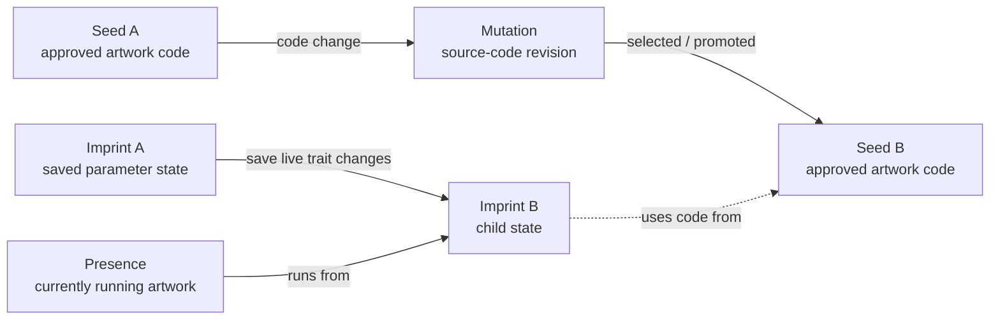

# ADR 0006: Local control service and artwork lineage

## Status

Accepted.

## Context

The first slice keeps the active seed and its parameters in browser
`localStorage` (ADR 0005). M2 needs durable artwork state, a record of how
source code changes over time, and a family tree of saved parameter
configurations. The presentation laptop has 4 GB of RAM, so the archive and
control service should add little operational overhead.

The renderer must remain useful if the control service, archive, network, or
hosted AI is unavailable. The M2 API is local-only; LAN access and
authentication are a separate M3 decision.

## Decision

### Names and model

The biological and mystical language describes the model; it does not require
that an artwork use an actual neural network.

- **Seed** is an approved, reusable artwork module. It identifies authored
  source code; it is not a running artwork or a saved parameter set.
- **Mutation** is a child source-code revision produced by changing a Seed's
  code. Mutations form their own parent/child lineage. A selected Mutation
  can be promoted to a new Seed; experimental Mutations need not be promoted.
- **Imprint** is a capture of an artwork's parameters (and random seed when
  applicable) at a point in time. Its captured values and provenance are
  immutable. It references the Seed and source revision whose code interprets
  those values. Saving live parameter changes creates a child Imprint of the
  prior saved Imprint; that child is the next node in the trait lineage, like
  an offspring state. An inactive Imprint can be deleted; its direct children
  are reparented to its former parent so the remaining lineage stays connected.
  This is a data capture, not a screenshot.
- **Presence** is the artwork currently running in the browser. It runs a
  particular Seed/source revision with an active Imprint. When a child Imprint
  is saved, the Presence can continue rendering while its active lineage
  advances to that child; the lineage is retained in Imprints rather than
  requiring a new browser process for every save.
- **Source revision** is the identifier for the code in a Seed or Mutation,
  such as a Git commit or build ID. It provides provenance so a saved Imprint
  can identify which implementation gave meaning to its parameters. It does
  not contain or archive that code.

**Refinement (storage model).** Seed and Mutation are two roles of one kind of
node, a code node with a parent; a Seed is a code node that has been promoted
(authored root modules are registered promoted). Code nodes and Imprints share
a lineage core (`id`, parent, creation time). A Presence is not a lineage node
but a mutable pointer to a code node and an optional Imprint, so selecting any
Seed, Mutation, or Imprint from the archive starts a Presence without writing
archive rows. An Imprint's parent must share its code node. See
[local-archive.md](../local-archive.md).

The two lineages are related but distinct. A source-code Mutation can produce
a new Seed, and an Imprint records which code revision it uses. Multiple
Imprints can use the same Seed; an Imprint can also use a newly promoted Seed.
This supports a simple tree view of Seeds and a detailed view that expands
their Imprints and running Presences. The underlying parent and reference
relationships do not depend on a particular visualization.

### Seed code immutability

Every Seed and Imprint must remain renderable. A registered Seed module is
never edited in place after Imprints reference it: a Mutation is a new module
registered under its own ID alongside its parent, so an Imprint's Seed ID
always resolves to the code it was saved with. The source revision (a Git
commit hash supplied by the caller) is provenance only; the archive records it
but never computes it or runs Git. Git history is never rewritten, so every
recorded revision stays retrievable. Bundled Seed source is not stored in or
run from the archive. Runtime Mutations created live are specified separately
in [ADR 0007](0007-live-mutation-code-and-sandbox.md).

### Storage and runtime

- Run a small local control service as a separate process from the browser
  renderer. Bind it to loopback by default. Keep its HTTP framework choice
  open for the API implementation issue.
- Use SQLite for authoritative active state, Seed and Mutation lineage, and
  Imprint metadata. Give each Seed, Mutation, and Imprint a stable unique ID.
  Store parent IDs for lineage and foreign-key references for the code
  revision used by each Imprint.
- Keep source revisions and Imprint content immutable. The active Presence
  points to its current Imprint. Saving changed parameters creates a child
  Imprint and updates the active reference in one transaction; transient
  slider movement does not create archive entries. Deleting an inactive
  Imprint reparents its children and removes the Imprint in one transaction;
  the active Imprint cannot be deleted.
- Validate Seed IDs and parameter values against the registered Seed's
  declarations before committing an Imprint. A write is durable only after
  its SQLite transaction commits. Failed writes must surface an error and
  must not be represented as saved.
- Run ordered, transactional schema migrations tracked by SQLite's
  `user_version`. Back up the database consistently and verify recovery by
  restoring it and checking source lineage, Imprint parent links, and the
  active reference.
- Let the browser render from its last-known-good local settings immediately;
  it must not wait for the service on startup or in the animation loop. When
  the service is available, its active Imprint is authoritative and the
  browser refreshes its local cache from that state. If it is unavailable,
  continue rendering the cached state.

## Consequences

- Source-code evolution and parameter-state evolution can be browsed
  independently or together without conflating code changes with live trait
  changes.
- Immutable Imprint content preserves saved parameter states; deleting an
  inactive Imprint preserves the remaining ancestry by reparenting its
  children. The Presence can move to a child Imprint without interrupting
  rendering.
- A source revision identifies code provenance but does not guarantee that
  historical code is bundled. Reproducing old output requires that code to
  remain available.
- SQLite provides transactional state and lineage without a separate
  database service. M2 Imprints contain parameter data, not rendered images,
  so no image-asset directory is required for this model.
- Loopback binding avoids exposing an unauthenticated control surface on the
  LAN in M2. M3 must decide authentication and any LAN binding before remote
  access is enabled.

## Alternatives considered

- **Browser `localStorage` as the archive:** retain it as a last-known-good
  rendering cache, but not as authoritative storage. It is browser-scoped and
  does not provide transactional lineage or shared access for a local
  service.
- **JSON files for all state:** simpler initially, but concurrent updates,
  referential integrity, and atomic changes across active state and lineage
  would need to be implemented manually. SQLite is a better fit for the
  relational metadata.
- **A separate database server:** rejected for M2 because it adds a service
  and resource burden without a need for multi-host database access.
- **A screenshot as the saved state:** rejected because an Imprint must
  capture editable parameters and ancestry, not only rendered pixels.
- **Make rendering depend on API availability:** rejected because a service
  outage must not blank or stop the artwork.

## Deferred choices

- API shape (decided in #11): plain `node:http`, JSON under `/api/v1`, and
  Server-Sent Events for Presence change notification. There is one Presence.
  See `docs/local-archive.md`.
- Remote network access and authentication are decided in
  [ADR 0008](0008-remote-studio-network-and-authentication.md); keep the M2
  service loopback-only until the remote configuration is implemented.
- Specify retention, pruning, and backup frequency before unattended
  operation.
- Decide how Mutations are generated and registered once evolution is
  implemented (M4). Until then, see "Seed code immutability" below.
